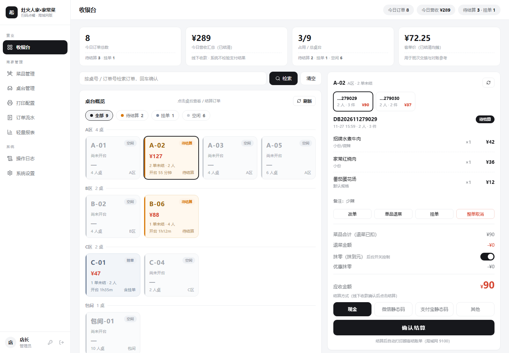
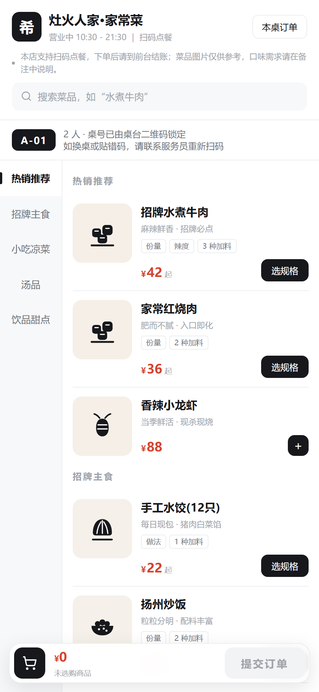
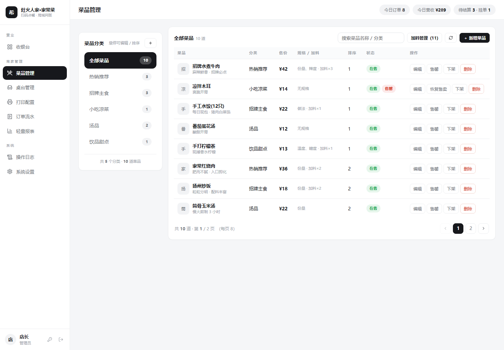
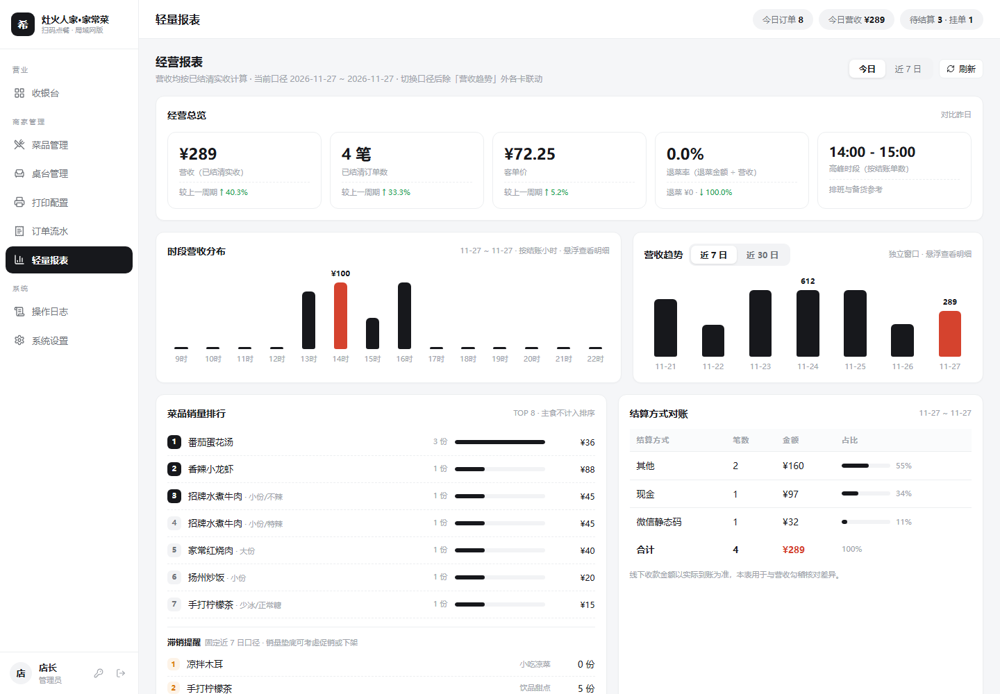
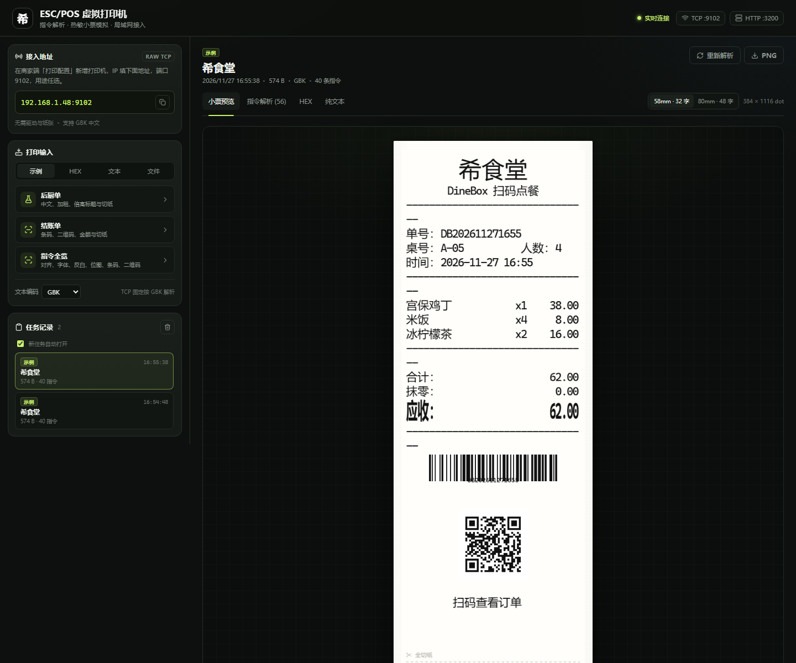

# DineBox · 堂食扫码点餐

> 扫码点餐、前台收银、后厨打印一体化的堂食点餐系统。
> 顾客 H5、商家管理 / 收银合并端、局域网 ESC/POS 打印，Docker Compose 一键部署。



## 功能特性

- **顾客扫码点餐**：桌号由二维码锁定，支持分类、搜索、规格差价、加料限选、购物车与整单备注；「本桌订单」同桌共享当前就餐会话，最后一批未结订单结清 / 取消后自动换新。
- **收银台**：按区域展示桌台实时状态（空闲 / 待结算 / 挂单），同桌多单、检索分页、改单、单品退菜、挂单 / 恢复、整单取消、抹零与四种线下结算方式。
- **商家管理**：菜品 / 分类 / 规格 / 加料、桌台区域与二维码、打印配置与 ESC/POS 模板、打印日志重打、订单流水 Excel 导出、经营报表、操作日志、账号与角色菜单权限。
- **局域网打印**：`node-thermal-printer` 生成 ESC/POS 指令，TCP 短连接直连打印机 `IP:9100`，中文 GBK；打印失败只记日志，不阻塞下单 / 结算。
- **ESC/POS 模拟器**：`apps/escpos` 接收真实 RAW TCP / HTTP 打印任务，解析指令并在网页模拟 58mm / 80mm 小票，附指令、HEX 与纯文本视图。
- **一键部署**：Docker Compose 编排 MySQL 8、Redis 7.4、RustFS、API、顾客 H5、商家端与 ESC/POS 模拟器，首次启动自动建表并写入演示数据。

## 页面预览

| 顾客 H5 · 点餐 | 商家 · 菜品管理 |
| --- | --- |
|  |  |

| 经营报表 | ESC/POS 虚拟打印机 |
| --- | --- |
|  |  |

## 技术栈

- **顾客 H5**：Next.js 15（App Router）、React 19、SWR、Tailwind CSS v4
- **商家端**：React 19、Vite、React Router、SWR、Zustand、Tailwind CSS v4、`qrcode`
- **API**：Node.js、Hono、`@hono/zod-openapi`、Zod、MySQL 8（mysql2 + Drizzle）、Redis（缓存 / 限流）、RustFS（S3 兼容菜品图片）
- **打印**：`node-thermal-printer`、ESC/POS、GBK、TCP 9100
- **ESC/POS 模拟器**：Hono + Node `net`、Vite + React 19、Canvas 小票渲染、`qrcode` / `JsBarcode`、SSE
- **工程**：pnpm workspace + Turborepo、TypeScript、ESLint、Docker Compose

## 快速开始

```powershell
# 构建并启动全部容器，等待健康检查
pwsh ./manage.ps1 up

# 日常运维
pwsh ./manage.ps1 status
pwsh ./manage.ps1 logs -Target api -Follow
pwsh ./manage.ps1 init            # 重建数据库与演示数据
pwsh ./manage.ps1 reset -Force    # 清空数据卷后重建
```

访问地址：

| 端 | 地址 |
| --- | --- |
| 顾客 H5 | <http://localhost:8090/?tk=tk_a1x9k2m4>（示例桌台 A-01） |
| 商家管理 / 收银 | <http://localhost:8091> |
| API | <http://localhost:3100>（文档 `/api/docs`，健康检查 `/health`） |
| ESC/POS 模拟器 | <http://localhost:8092>（虚拟打印机 TCP `9102`） |
| RustFS 控制台 | <http://localhost:9101> |
| MySQL / Redis | `localhost:3307` / `localhost:6380` |

演示账号密码均为 `123456`：

| 账号 | 角色 |
| --- | --- |
| `admin` | 管理员 |
| `cashier01` | 收银员 |

`manage.ps1 up` 会自动识别本机局域网 IPv4 并写入 H5 与模拟器的对外地址；手机需与门店主机处于同一局域网。

本地热更新（仅用容器跑 MySQL / Redis / RustFS）：

```powershell
docker compose -f scripts/docker-compose.yml up -d --wait mysql redis rustfs
cd dinebox-monorepo
pnpm install
cp apps/api/.env.example apps/api/.env
pnpm dev:api        # http://localhost:3100
pnpm dev:web        # http://localhost:3001
pnpm dev:admin      # http://localhost:3002
pnpm dev:escpos     # http://localhost:3003（虚拟打印机 TCP 9102）
```

质量检查：`cd dinebox-monorepo && pnpm typecheck && pnpm lint && pnpm build`

## 打印与配网

- 打印机需支持 RAW TCP 9100 / ESC/POS，与部署 API 的主机处于同一局域网；建议在路由器绑定静态 IP。
- 后台「打印配置」填写名称、IP、端口与用途（后厨小票 / 结账单 / 通用），保存后点击「测试」验证。
- 模板占位变量：`{title}` `{table}` `{order_no}` `{time}` `{items}` `{note}` `{total}` `{off}` `{payable}` `{people}`。
- 没有实体打印机时，在打印配置中填写「运行模拟器主机的局域网 IP:9102」，即可在浏览器查看真实打印字节渲染的小票。

## 目录结构

```text
DineBox/
├── docs/                    # 功能清单、设计说明、原型、数据库设计、截图
├── scripts/                 # Docker Compose、初始化 SQL、演示数据生成
├── manage.ps1               # 启动 / 日志 / 初始化 / 重置 / 开发模式
└── dinebox-monorepo/
    ├── apps/
    │   ├── api/             # Hono API（routes → controllers → services → sql）
    │   ├── web/             # 顾客扫码点餐 H5（Next.js）
    │   ├── admin/           # 商家管理 + 收银合并端（React + Vite）
    │   └── escpos/          # ESC/POS 虚拟打印机（TCP + 指令解析 + 小票预览）
    └── packages/            # types、db、print、storage、cache、logger、utils、ui
```

## 文档

- [功能清单](docs/扫码点餐系统-功能清单-v1.md)
- [功能设计说明](docs/扫码点餐系统-功能设计说明-v1.md)
- [数据库设计](docs/扫码点餐系统-数据库设计-v1.sql)
- [顾客 H5 原型](docs/扫码点餐系统-顾客H5原型-v1.html)
- [商家端原型](docs/扫码点餐系统-admin管理端原型-v1.html)

## 赞助支持

如果这个项目对你有帮助，欢迎通过爱发电支持作者。可使用支付宝或微信扫码赞助：

<p align="center">
  <a href="https://ifdian.net/a/sylvie233">
    
  </a>
</p>

爱发电主页：<https://ifdian.net/a/sylvie233>

## License

[MIT](LICENSE)
